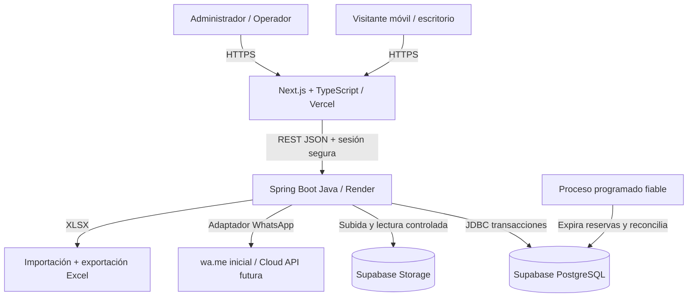
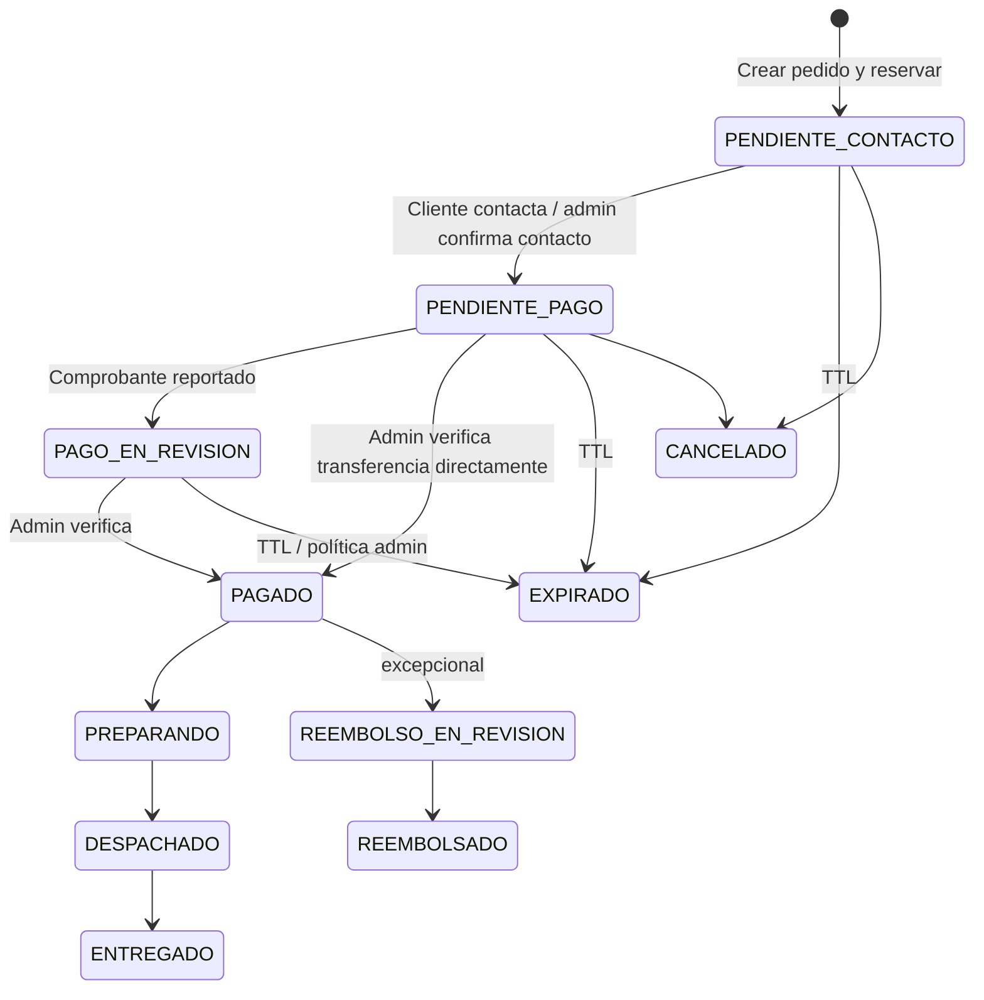

# ALEXA BEAUTY — PLAN MAESTRO DE DESARROLLO

> **Versión:** 1.0 · **Fecha:** 10 de octubre de 2026 · **Estado:** especificación para construcción, no implementación verificada.
>
> **Objetivo:** desarrollar una plataforma de comercio de maquillaje centrada en móviles, con catálogo público, carrito, pedido asistido por WhatsApp, confirmación manual de pagos, inventario trazable, carga masiva de Excel, control de recepción de mercancía, ventas y análisis.
>
> **Tecnologías acordadas:** Java (backend), PostgreSQL de Supabase, Render (API), Vercel (frontend). **Tecnologías propuestas:** Spring Boot, Next.js con TypeScript, Supabase Storage, Apache POI, Flyway, Playwright y Testcontainers.

## 0. Lectura y decisiones de proyecto

**Regla principal:** el sistema será la fuente única de verdad de productos, stock, precios y pedidos. WhatsApp es el canal de conversación y el administrador confirma los pagos; un mensaje de WhatsApp no equivale a una venta pagada.

**Entregables finales exigidos:** repositorio organizado; UI mobile-first; API Java segura; BD versionada; almacenamiento de imágenes; importador XLSX con plantilla generada por la misma app; módulo de stock/recepciones; pedidos y pagos; reportes XLSX filtrados; analíticas; WhatsApp desacoplado; pruebas automatizadas; despliegues, monitorización, backups, guía de uso y manual de operación.

**Alcance confirmado del usuario:** catálogo visible al público; sólo productos disponibles para comprar; carrito; envío del pedido a WhatsApp Business; administrador capaz de marcar pagado; descuento/control de inventario; alta individual y por Excel; imágenes por producto; reabastecer productos existentes buscándolos; trazabilidad de entradas; ventas filtrables por día y exportables a Excel; productos más vendidos; diseño de alta calidad prioritariamente móvil.

**Supuestos configurables iniciales:** moneda COP; zona horaria `America/Bogota`; idioma español; pago por transferencia/Nequi/Daviplata u otro medio validado manualmente; clientes compran sin crear cuenta; un negocio/almacén; un administrador propietario y posibilidad de colaboradores; entregas coordinadas por WhatsApp. No se incluye pasarela de cobro automático en el MVP.

**Decisiones a validar con el dueño antes de producción:** número de WhatsApp Business y titularidad; tarifas/zonas de envío; medios de pago; política de cancelaciones y devoluciones; si habrá variantes por tono/tamaño; obligatoriedad de captura de costo de compra y lote/caducidad; número de operadores; aviso de privacidad y datos del negocio; dominio propio; plazo definitivo para reservas de stock.

---

## 1. Arquitectura y responsabilidades



**Frontend — Vercel:** Next.js App Router, TypeScript, Tailwind CSS, accesibilidad por teclado, componentes reutilizables, páginas públicas indexables, panel administrativo protegido, carrito persistente localmente, formularios validados y estados de carga/error/vacío. Ninguna consulta privilegiada del navegador directo a Postgres.

**Backend — Render:** Java 21 LTS y versión estable compatible de Spring Boot al comenzar, Spring Web, Validation, Security, Spring Data JPA/JDBC, Flyway, PostgreSQL JDBC, Apache POI, OpenAPI, Actuator, manejo centralizado de errores, rate limiting, logs estructurados. Dominio separado en catálogo, inventario, pedidos, pagos, ventas, reportes, usuarios, auditoría e integraciones.

**Datos — Supabase:** PostgreSQL con migraciones SQL en Git, claves y restricciones, índices y transacciones ACID. Para Render persistente: usar la conexión directa si IPv6 está disponible o el *session pooler* si el entorno sólo tiene IPv4; copiar la cadena real de Supabase, exigir TLS y ajustar HikariCP al límite contratado. No aplicar ciegamente el pool transaccional JDBC con sentencias preparadas.

**Imágenes — Supabase Storage:** bucket público sólo para imágenes comerciales; escritura exclusiva y autenticada desde backend; bucket privado para comprobantes si llegaran a guardarse. En Postgres persistir rutas y metadatos, no bytes. Optimizar imágenes a WebP/AVIF/JPEG según compatibilidad y eliminar metadatos EXIF.

**Integración WhatsApp:** interfaz `WhatsAppGateway` con adaptadores `ClickToChatGateway` (MVP) y `CloudApiGateway` (fase avanzada, con credenciales, webhooks, plantillas y permisos). MCP podrá ser puente opcional del servicio autorizado pero **no es sinónimo de WhatsApp Cloud API ni se presupone compatible con producción**. Un enlace `wa.me` abre un mensaje prellenado; el usuario debe enviarlo.

**Dependencias externas (a confirmar antes de codificar):** disponibilidad de planes y límites gratuitos/pagos de Render/Vercel/Supabase; requisitos de Meta Business; proveedor de correo SMTP opcional; dominio y respaldo externo. Los cron o trabajadores de expiración no deben depender de un servidor que duerma.

---

## 2. Experiencia de usuario, diseño y marca

### 2.1 Identidad de Alexa Beauty

- **Imagen de marca entregada:** ilustración circular de dos personas con cabello rizado y gafas, borde vino oscuro, fondo rosa malva, base crema. Se entrega una **propuesta refinada** separada de la imagen original para aprobación de sus dueños. Nunca reemplazar el original sin confirmación.
- **Concepto:** cosméticos acogedores, cercanos, femeninos y elegantes; estética boutique premium sin saturar de rosa.
- **Eslogan provisional:** «Tu belleza, tu esencia.» (validar con el negocio).
- **Tokens sugeridos:** `--wine: #711A38`, `--wine-dark: #4C1126`, `--mauve: #B7748C`, `--blush: #F5E5E8`, `--cream: #FCF8F2`, `--white: #FFFFFF`, `--ink: #2B2025`, `--muted: #74646C`, `--success: #22795B`, `--border: #E8DCE0`.
- **Tipografía:** títulos `Playfair Display` o `DM Serif Display`; interfaz y precios `Inter` o `Manrope`; fuentes cargadas con fallback accesible y sin saltos visuales.
- **Componentes:** tarjetas redondeadas 16–20 px; botones con min. 44–48 px de área táctil; sombra suave; iconos consistentes; chips de categorías; textos de alto contraste; fotografías uniformes 1:1; jerarquía visual fuerte en precio, nombre, tono y disponibilidad.
- **Movimiento:** transiciones discretas de 120–200 ms, respetar `prefers-reduced-motion`.

### 2.2 Mapa del sitio — público

| Ruta | Contenido y propósito |
|---|---|
| `/` | Hero de marca, categorías, destacados, productos nuevos, beneficios, acceso al catálogo y WhatsApp |
| `/catalogo` | Listado paginado, búsqueda, filtros por marca/categoría/precio/disponibilidad y orden |
| `/producto/[slug]` | Fotos, variantes/tonos, precio, existencias visibles como estado, descripción, cantidad, agregar al carrito |
| `/carrito` | Artículos, cambiar cantidades, quitar artículos, subtotal y CTA continuar pedido |
| `/pedido` | Nombre, WhatsApp/teléfono, forma de entrega, ciudad/dirección sólo si requiere, notas, consentimiento, revisión final |
| `/pedido/confirmado/[referencia]` | Confirmación de pedido guardado y botón para continuar conversación; no proclamar pago |
| `/seguimiento` | Consulta de estado mediante referencia + token privado/código seguro, no por UUID público |
| `/politica-privacidad`, `/terminos`, `/envios`, `/contacto` | Transparencia comercial y datos personales |

**Flujo móvil ideal:** entrar → ver productos → filtrar o buscar → seleccionar tono y cantidad → agregar al carrito → confirmar datos → servidor valida y reserva → se crea referencia → abrir WhatsApp prellenado → cliente envía mensaje → administrador verifica transferencia → marca pagado → stock y reportes se actualizan.

**Navegación móvil:** cabecera compacta con logo, buscar y carrito con contador; categorías en scroll horizontal; en pantallas muy pequeñas navegación inferior discreta (`Inicio`, `Catálogo`, `Carrito`, `Contacto`) sin tapar CTA; CTA de pedido fijo en el pie del carrito; paneles tipo drawer para filtros. Pantallas de referencia 360, 390, 430, 768, 1024, 1440 px.

**Estados críticos:** sin resultados, stock agotado, imagen faltante, carga lenta, pérdida de red, pedido duplicado, pedido expirado, cantidad mayor que stock, WhatsApp no disponible, fallo de confirmación del pago. Cada estado tendrá mensaje accionable.

### 2.3 Panel admin — mobile-first pero eficaz en escritorio

`/admin/login`, `/admin`, `/admin/productos`, `/admin/productos/nuevo`, `/admin/importar`, `/admin/inventario`, `/admin/entradas`, `/admin/pedidos`, `/admin/ventas`, `/admin/analitica`, `/admin/reportes`, `/admin/configuracion`, `/admin/auditoria`.

**Dashboard:** tarjetas ventas cobradas hoy / últimos 7 y 30 días / pedidos por confirmar / stock bajo / productos activos; gráfica de tendencia; top productos; últimos pedidos; botones de acciones rápidas «Nuevo producto», «Recibir mercancía», «Importar Excel» y «Exportar ventas».

**En móvil:** tablas pasan a tarjetas plegables; filtros abren panel lateral; acciones de aprobación tienen confirmación; formularios divididos por pasos cortos; botones de uso frecuente siempre visibles. **En escritorio:** sidebar y tablas compactas, selección por filas, atajos de teclado opcionales.

**Accesibilidad:** WCAG 2.2 AA como objetivo; contrastes medidos, foco visible, labels, errores ligados al campo, navegación teclado, lectores de pantalla, alt text, no depender sólo del color, soporte zoom 200%.

### 2.4 Calidad visual y SEO

Optimizar imágenes, lazy-load fuera de pantalla, `next/image` con orígenes configurados; indexar sólo catálogo público; títulos y descripciones por producto; Open Graph, favicon, sitemap, metadata por producto; sin indexación en admin y seguimiento. Core Web Vitals y Lighthouse en móvil, con presupuestos de rendimiento y evaluación en red lenta.

---

## 3. Dominio de datos y relaciones

Todos los identificadores internos UUID; montos `NUMERIC(12,2)` (nunca `float` para dinero); fechas `TIMESTAMPTZ` UTC, mostradas en `America/Bogota`; teléfono en formato E.164 cuando proceda; auditoría inmutable. Códigos públicos amigables del tipo `AB-2026-000123` únicos.

| Tabla | Campos principales / comportamiento |
|---|---|
| `users` | id, nombre, email único, `password_hash`, rol ADMIN/OPERADOR, activo, ultimo_acceso, MFA futuro |
| `brands` | id, nombre normalizado, slug, activo |
| `categories` | id, nombre, slug, orden, activo |
| `products` | id, sku único o generado, nombre, slug único, marca_id, categoría_id, descripción, activo, destacado, creado/actualizado |
| `product_variants` | id, product_id, sku único, tono, tamaño/presentación, precio_venta, costo_referencia opcional, stock_minimo, activo, `stock_on_hand`, `stock_reserved`, `version` |
| `product_images` | id, product_id, variant_id opcional, ruta_storage, alt, orden, principal |
| `inventory_movements` | id, variant_id, tipo ENTRADA/VENTA/SALIDA/AJUSTE/DEVOLUCION, `quantity_delta`, qty_before, qty_after, referencia, motivo, usuario_id, fecha; nunca borrar |
| `stock_receipts` + `stock_receipt_items` | ingreso de mercancía, proveedor opcional, factura opcional, unidades, costo, observaciones, fecha, usuario responsable |
| `orders` | id, referencia única, cliente_nombre, cliente_telefono, entrega, nota, subtotal, descuento, envío, total, estado, canal, `expires_at`, timestamps, token seguimiento hasheado |
| `order_items` | id, pedido, variant_id, SKU/nombre/tono/precio_unitario **congelados**, cantidad, subtotal, costo_snapshot opcional |
| `stock_reservations` | id, pedido, variant_id, cantidad, vence, estado ACTIVE/CONSUMED/RELEASED, timestamps |
| `payments` | id, pedido, método, referencia transferencia, monto, estado PENDING/VERIFIED/REJECTED/REFUNDED, verificador, fecha_verificación, nota; comprobante privado opcional |
| `order_status_history` | cada transición, estado anterior/nuevo, usuario, observación, fecha |
| `excel_import_jobs` + `excel_import_errors` | hash archivo, usuario, versión plantilla, registros, válidos/rechazados, resultados, errores por fila, fecha |
| `notification_events` | eventos de mensajería, proveedor, estado, reintentos, referencia externa, idempotencia |
| `audit_logs` | actor, acción, entidad, id entidad, antes/después sanitizado, fecha/IP cuando corresponda |
| `app_settings` | WhatsApp, moneda, reglas de envío, reservas, textos legales, umbrales configurables |

**Índices esenciales:** `product_variants(sku) UNIQUE`, `products(slug) UNIQUE`, `orders(reference) UNIQUE`, `orders(created_at)`, `orders(paid_at)` o fecha verificación en payments, `order_items(variant_id)`, `inventory_movements(variant_id, created_at)`, `product_images(product_id, sort_order)`, `stock_reservations(expires_at, status)`; índices para búsqueda de nombres/marcas según el volumen (trigramas si es necesario). `CHECK stock_on_hand >= 0`, `CHECK stock_reserved >= 0`, `CHECK stock_reserved <= stock_on_hand`, `CHECK precio_venta >= 0`, `CHECK quantity > 0`.

**Preferencia de modelo:** las existencias pertenecen a la variante vendible (p. ej. base tono 03 ≠ base tono 04). Si inicialmente no existen tonos, cada producto tiene una variante `DEFAULT` creada automáticamente. Evita rehacer toda la BD después.

**No borrar ventas, movimientos ni pedidos históricos:** desactivar productos y preservar snapshots. El inventario nunca se ajusta simplemente editando el número de stock sin registrar motivo.

---

## 4. Reglas de negocio inviolables (sobreventa y ventas falsas)

### 4.1 Ecuación de inventario

`stock_disponible = stock_on_hand - stock_reserved`.

- **Recepción nueva mercancía:** incrementa `stock_on_hand` y genera movimiento `ENTRADA` con referencia a recepción; no cambia automáticamente el número reservado.
- **Creación de pedido:** bajo transacción PostgreSQL, bloquear filas de variantes (`SELECT ... FOR UPDATE` en orden determinista de IDs), comprobar disponibilidad, aumentar `stock_reserved` y registrar reservas activas. Persistir pedido y artículos al mismo tiempo. Si alguna línea no tiene cantidad, revertir todo con HTTP 409 y explicar cambios.
- **Marcar pedido PAGADO:** sólo rol autorizado, comprobación humana explícita, verificar método y monto, consumir reservas (`stock_reserved -= cantidad`, `stock_on_hand -= cantidad`), crear movimiento `VENTA` por variante, registrar pago/historial. **Una única transacción**. Si ya está pagado, no descontar de nuevo (operación idempotente).
- **Cancelar o expirar pedido NO PAGADO:** liberar sólo `stock_reserved`, no `stock_on_hand`, en transacción; prohibir pagos sobre pedidos expirados sin una nueva validación/re-reserva del stock.
- **Devolución de pedido PAGADO:** proceso aparte con autorización, reembolso y decisión de reingreso al inventario (`DEVOLUCION`) si la condición de producto cosmético lo permite; nunca sumar stock automáticamente sin revisión.
- **Ajustes:** corrección de conteo con motivo obligatorio, confirmación, auditoría y prohibición de dejar `on_hand < reserved`.

**Ejemplo auditado:** hay 10 labiales, dos clientes reservan 3 y 4 → `on_hand=10`, `reserved=7`, `available=3`. Cliente 1 paga → `on_hand=7`, `reserved=4`, `available=3`. Cliente 2 expira → `on_hand=7`, `reserved=0`, `available=7`.

### 4.2 Reserva y expiración

Valor inicial configurable: **45 minutos** para pedido recién creado (ajustar a operación real). En WhatsApp el vendedor puede extender la reserva con una acción administrativa controlada, dejando evidencia y límite. Proceso fiable cada 5 minutos mediante worker/cron externo o servicio siempre activo; además, cada creación/consulta transaccional relevante identifica reservas vencidas antes de tomar decisiones. Los tiempos siempre los decide el servidor. No asumir que un cron de Spring dentro de una instancia gratuita dormida ejecuta puntualmente.

### 4.3 Pedido y estados



La web no puede saber con fiabilidad que el cliente *envió* el texto de `wa.me`; sólo sabe que abrió el enlace. Por tanto `PENDIENTE_CONTACTO` no pasa automáticamente a `PENDIENTE_PAGO` hasta confirmación administrativa o evento oficial de API. Prohibir transición directa `EXPIRADO -> PAGADO` sin recuperación transaccional segura.

### 4.4 Idempotencia y concurrencia

- `POST /orders` recibe `Idempotency-Key` para reintentos del navegador; índice único por token/actor y ventana. Dos clics no crean dos reservas.
- `POST /orders/{id}/confirm-payment` requiere clave idempotente, `@Transactional`, lock del pedido, precondiciones, usuario autenticado y auditoría. Dos operadores simultáneos producen una venta, no dos.
- `stock_receipts` también requiere idempotencia: registrar el mismo ingreso dos veces no duplica inventario.
- Importación Excel almacena hash/fingerprint y advierte archivo ya procesado; decisiones explícitas sobre reimportar.
- **Regla de precio:** el cliente ve precios recientes, pero el servidor recalcula totales y congela el precio en cada línea del pedido; nunca acepta total enviado por el navegador como autoritativo.

---

## 5. Módulos y casos de uso con criterios de aceptación

### M01. Autenticación y roles

- Login admin email/contraseña; hash fuerte BCrypt o Argon2; sesión segura en cookie `HttpOnly`, `Secure`, `SameSite`, CSRF protegido según arquitectura elegida; expiración, cierre de sesión, recuperación autenticada; políticas de contraseñas y rate limiting.
- `ADMIN`: usuarios, configuración, productos, ajustes, pagos, auditoría, reportes.
- `OPERADOR` futuro: pedidos, recepción y catálogo; no gestionar usuarios ni borrar registros. Política default deny para cada endpoint.
- Usuarios públicos no necesitan cuenta. No exponer secretos ni credenciales Supabase privilegiadas al cliente.
- **Aceptación:** acceso a `/admin` redirige sin sesión; un operador no puede ejecutar acciones de propietario ni enviando HTTP manualmente.

### M02. Marcas, categorías, productos y variantes

- Alta individual con SKU sugerido único, nombre, marca, categoría, descripción, tono, presentación, costo opcional, precio COP, stock inicial, stock mínimo, imágenes y estado publicado.
- Editar datos; publicar/despublicar; buscar; filtros; duplicar ficha opcional; historial; sin borrar entidades con movimientos.
- Alta de stock inicial genera movimiento `ENTRADA_INICIAL` y referencia de auditoría.
- **Aceptación:** producto/tono agotado no se puede pedir; imagen rota muestra placeholder; mismo SKU no se duplica; precio negativo se rechaza.

### M03. Carga masiva de productos en Excel

Flujo: `Descargar plantilla` → completar → seleccionar `.xlsx` → analizar en servidor → vista previa de N filas e incidencias → elegir política de duplicados → confirmar importación → estado y reporte de resultados.

**Plantilla productos v1:** hoja `PRODUCTOS`, fila 1 con encabezados **exactos** y metadato versión en hoja `INSTRUCCIONES` o en metadatos del archivo, sin desplazar encabezados. Columnas:

| Columna | Obligatoria | Validación y semántica |
|---|---|---|
| `nombre` | Sí | 2–150 caracteres, limpio |
| `marca` | Sí | nombre 2–100, crear si no existe sólo tras aprobación de importación |
| `stock_inicial` | Sí | entero >=0; sin decimales, no negativo |
| `precio_venta_cop` | Sí | número no negativo; aconsejado >0 para publicar |
| `sku` | No | único; si vacío generar SKU estable con contador/secuencia; no inferir que mismo nombre es mismo SKU |
| `categoria` | No | texto válido/categoría existente o creación confirmada |
| `tono` | No | ej. Nude 01; identifica variante junto con SKU |
| `presentacion` | No | ej. 30 ml |
| `costo_unitario_cop` | No | numérico >=0, útil para margen |
| `stock_minimo` | No | entero >=0, recomendado 3–5 según venta |
| `descripcion` | No | texto hasta longitud definida |
| `publicado` | No | SI/NO, por defecto NO si faltan precio o fotos, decidir regla |

El archivo entregado incluye hoja vacía para importar, instrucciones y ejemplos en hoja separada. **Jamás importar la hoja de ejemplo**.

Validaciones obligatorias: extensión `.xlsx` exclusivamente, tamaño y filas configurables (inicio sugerido 5 MB/5.000 filas), tipos reales de celda, cabeceras, valores obligatorios, duplicados internos y de BD, fórmulas/macros rechazadas, archivos malformados, campos desbordados, precios/cantidades inválidos; neutralizar *formula injection* al exportar texto. Al analizar, mostrar `fila`, `campo`, `valor`, `problema`, `solución`; no guardar parcialmente un lote con errores sin consentimiento explícito. Política preferida por defecto: importación **atómica todo-o-nada** y opción posterior de descargar «filas rechazadas». Lotes grandes pueden transaccionarse en chunks con un job durable y reglas de reanudación verificables.

**Conflictos:** SKU existente nunca se recrea ni aumenta stock automáticamente; ofrecer `OMITIR`, `ACTUALIZAR CAMPOS` (sin tocar stock), o cancelar. Las **entradas** de unidades existentes van por el módulo de recepción. Importar por Excel no exige imagen; adjuntarla después por búsqueda/SKU; carga de imágenes múltiple por ZIP nombrado según SKU es mejora posterior.

**Aceptación:** descargar archivo generado por la aplicación, completar 100 nuevos productos y subirlos → la vista previa informa 100 altas → confirmación crea 100 y movimientos iniciales exactamente una vez. Repetir archivo advierte duplicados y no altera el stock.

### M04. Recepción de mercancía / añadir existencias

- Campo buscador por nombre, SKU, marca y tono (autocompletado); selección de 1..N productos existentes; cantidad recibida positiva, costo opcional, proveedor/referencia factura, fecha y observación.
- Vista «Antes / Entrada / Después»; confirmar recibo; escribir stock y libro de movimientos en una sola transacción; listado historial con quién, cuándo y motivo; detalle de recepción y descarga de comprobante interno.
- Módulo independiente de `Ajustar inventario`; **recepción** no reemplaza existencias, **suma**. Ajuste absoluto sólo con causa declarada.
- **Aceptación:** producto stock 5 + entrada 20 = stock físico 25, con 2 registros preservados (stock previo y movimiento nuevo); doble envío no genera 45.

### M05. Imágenes de producto

- Subir al crear o editar producto; varias fotografías; portada obligatoria antes de publicar si el negocio lo decide, orden drag-and-drop y eliminación con confirmación; vista por tono opcional.
- Validar tipo real y MIME `image/jpeg`, `image/png`, `image/webp`; dimensión y peso máximos configurables; recodificar, quitar EXIF, miniaturas, alt text; usar rutas estables en Storage, no base64 en BD.
- No aceptar SVG arbitrario/HTML como imagen sin sanitización. Administradores autenticados; no permitir que visitantes suban contenidos.
- **Aceptación:** carga imagen, aparece en móvil y escritorio, conserva proporción 1:1, imágenes fallidas no publican URL rota.

### M06. Catálogo, búsqueda y carrito

- Catálogo con paginación, buscador con debounce, orden (relevancia, novedades, precio), categorías, marca, rango precio, «Sólo disponibles», variantes de tonos.
- Producto sólo seleccionable si `available>=qty`; stock revalidado al comprar. Precios COP legibles (`$ 25.000`); descuentos sólo si se implementa campaña con rango de fechas.
- Carrito persistido localmente, **no reserva hasta crear pedido**; control de cantidades y desactivar agotados; en checkout se verifica todo en servidor.
- **Aceptación:** sin cuenta pública se compra desde móvil; si un artículo se agota antes de confirmar el pedido, usuario ve aviso y alternativa.

### M07. Checkout y contacto WhatsApp

- Checkout ligero: nombre, teléfono/contacto, modalidad retiro/envío, ciudad y dirección condicional, método de pago estimado, observaciones y aceptación de tratamiento de datos.
- Crear pedido y reservas antes de abrir WhatsApp. Resultado devuelve `orderReference`, resumen de ítems, `expiresAt` y URL calculada en backend o construida con datos del backend confiables, con URL encoding y teléfono del negocio almacenado en configuración.
- Mensaje recomendado:

```
Hola, Alexa Beauty 🌷
Quiero consultar y confirmar mi pedido AB-2026-000123:
• Labial Mate Nude 01 × 2 — $ 36.000
• Rubor Rosa Suave × 1 — $ 24.000
Subtotal: $ 60.000
Entrega: por coordinar
Nombre: [nombre proporcionado]
¿Me ayudan a confirmar disponibilidad y cómo realizar el pago?
```

- Nunca decir «pedido enviado» sólo porque se abrió WhatsApp; expresar «Pedido guardado. Pulsa Enviar en WhatsApp para conversar con la tienda». Fallback: copiar texto y botón abrir WhatsApp; si la persona cierra sin enviar, el pedido caduca.
- Enviar identificador, no datos bancarios secretos; minimizar datos personales en URLs de terceros; si hay dirección detallada, mejor coordinarla dentro de WhatsApp.
- **Aceptación:** hay una referencia única en BD y el mismo importe congelado que ve admin; un refresco/reintento no duplica la reserva.

### M08. Panel de pedidos, verificación de pagos y operación

- Bandeja con filtros por estado, fecha, cliente, referencia; búsqueda; detalle con ítems, precios al momento de compra, reservas y conversación/contacto.
- Acciones: confirmar contacto, marcar en revisión, **marcar pagado** con formulario de verificación (método, monto, comprobante/referencia opcional, verificador, confirmación), cancelar, extender reserva, preparar, despachar, entregar.
- Pago parcial: fuera del MVP o flujo separado claramente definido; en MVP pago completo únicamente. Prohibir «pagado» si monto no coincide sin decisión de administración registrada.
- Estados y acciones registrados en historial. Si el pedido expira y la transferencia llegó después, admin debe revalidar stock y resolver manualmente, nunca forzar descuento negativo.
- **Aceptación:** marcar pagado exactamente una vez genera una venta real; pendientes y expirados no cuentan como ingresos; la reversión está controlada.

### M09. Ventas y exportación profesional a Excel

- Ventas cobradas basadas en **fecha real de verificación de pago**, no fecha de creación del pedido. Filtros por día, intervalo, semana/mes, método, producto, categoría, marca y operador; `America/Bogota` para mostrar fechas y convertir a UTC en queries (`>= inicio`, `< día siguiente`).
- Totales: ingresos cobrados, unidades vendidas, tickets, ticket promedio, descuentos, envío cobrado (si existe), pedidos cancelados aparte. Margen bruto estimado sólo cuando haya costo por unidad capturado en snapshot; no confundir ingresos con ganancia.
- `Exportar Excel según filtros activos`; workbook sugerido:
  1. `RESUMEN`: logo/nombre, período, filtros, fecha exportación, 4 KPIs, totales, notas.
  2. `VENTAS`: fecha pago, referencia, cliente según permisos, estado, método, subtotal, descuento, envío, total, responsable.
  3. `DETALLE_PRODUCTOS`: pedido, SKU, producto, marca, tono, cantidad, precio unitario, total línea, costo snapshot si disponible.
  4. `TOP_PRODUCTOS`: rank, SKU, producto, unidades, ingreso, participación (%), categoría/marca.
  5. `METADATOS`: moneda COP, zona horaria, usuario exportador, filtros y criterio temporal, versión formato.
- Plantilla refinada con bordó/malva, filas alternas, filtros, congelar encabezados, formato COP y fechas, anchos legibles, totales con fórmulas, nombres de tablas consistentes, gráfico sencillo en Resumen si la biblioteca lo soporta con fiabilidad. Exportación protegida con permisos, registros de auditoría y límites de volumen.
- **Aceptación:** seleccionar «del 10 al 12 de octubre» muestra exactamente ventas pagadas en ese intervalo local y exporta exactamente la misma selección; subtotales/totales de detalle cuadran con el resumen.

### M10. Estadísticas y top de ventas

- Gráficas: ventas cobradas por día/semana/mes, tendencia, top 10 por unidades e ingresos, participación por marca/categoría, stock bajo, productos estancados, valor estimado del inventario, ventas por método.
- Valores calculados por consultas de agregación sobre pagos verificados y `order_items` snapshots; productos más vendidos se definen por **unidades** (top por ingresos por separado). Una devolución descuenta del neto según política y fechas, mostrar métricas brutas y netas cuando haya reembolsos.
- Filtros compartidos con ventas. Etiquetas visibles para «últimos 30 días», horarios y moneda.
- **Aceptación:** pedidos pendientes no incrementan top; un pedido con dos unidades computa 2; las gráficas cuadran con el Excel exportado.

### M11. Configuración, historial y mantenimiento

- Configurar WhatsApp E.164, modalidad de entregas, costos de envío, texto de confirmación, días de devolución, duración de reserva, stock mínimo y marca gráfica.
- Registro de acciones privilegiadas, filtros y exportación de auditoría (sin secretos o contraseñas). Copias de seguridad y restauración probada, import/export de datos de emergencia, comunicaciones ante incidentes.
- **Aceptación:** cambios de número de contacto reflejan nuevos links, sin tocar pedidos históricos; acciones de alto impacto se atribuyen a usuario.

---

## 6. Contrato REST propuesto (`/api/v1`)

**Públicos (con rate limiting):**

| Método | Endpoint | Resultado |
|---|---|---|
| `GET` | `/catalog/products?q=&brand=&category=&minPrice=&maxPrice=&inStock=&page=&size=&sort=` | Listado paginado público |
| `GET` | `/catalog/products/{slug}` | Detalle + fotos + variantes + disponibilidad |
| `GET` | `/catalog/categories` | Categorías activas |
| `GET` | `/catalog/brands` | Marcas activas |
| `POST` | `/orders` | Checkout transaccional y creación de reserva |
| `GET` | `/orders/track?reference=...&token=...` | Estado público de alcance mínimo |
| `GET` | `/health/public` | Estado mínimo sin secretos, opcional |

**Privados ADMIN/OPERADOR (RBAC preciso):**

| Método | Endpoint | Resultado |
|---|---|---|
| `POST` | `/auth/login` | Autenticación segura |
| `POST` | `/auth/logout` | Revocar sesión |
| `GET/POST` | `/admin/products` | Listar/crear productos |
| `GET/PATCH` | `/admin/products/{id}` | Detalle/edición controlada |
| `POST/DELETE` | `/admin/products/{id}/images` | Gestionar fotos |
| `GET` | `/admin/products/import/template` | Descargar XLSX v1 |
| `POST` | `/admin/products/imports/preview` | Validar XLSX sin persistir |
| `POST` | `/admin/products/imports/{jobId}/commit` | Ejecutar importación idempotente |
| `GET` | `/admin/products/imports/{jobId}` | Resultado/errores |
| `POST` | `/admin/inventory/receipts` | Recibir mercancía |
| `GET` | `/admin/inventory/movements` | Kardex / movimientos |
| `POST` | `/admin/inventory/adjustments` | Ajuste excepcional auditado |
| `GET` | `/admin/orders` | Pedidos filtrables |
| `GET` | `/admin/orders/{id}` | Detalle |
| `POST` | `/admin/orders/{id}/confirm-payment` | Pago verificado atómico |
| `POST` | `/admin/orders/{id}/transition` | Transición validada |
| `POST` | `/admin/orders/{id}/extend-reservation` | Extensión auditada |
| `GET` | `/admin/sales` | Ventas pagadas filtradas |
| `GET` | `/admin/sales/export.xlsx` | Excel mismo filtro y mismo cálculo |
| `GET` | `/admin/analytics/overview` | KPIs y series |
| `GET` | `/admin/analytics/top-products` | Top por unidades/ingresos |
| `GET` | `/admin/audit` | Auditoría, sólo autorizado |
| `GET/PATCH` | `/admin/settings` | Ajustes, sólo propietario |
| `GET/POST` | `/integrations/whatsapp/webhook` | Sólo si se habilita Cloud API; autenticado/verificado por firma |

**Convenciones API:** DTOs separados de entidades JPA; respuesta de error con `code`, `message`, `fieldErrors`, `requestId`; `400` validación, `401` no autenticado, `403` rol insuficiente, `404` no encontrado, `409` conflicto stock/estado/idempotencia, `422` regla negocio, `429` frecuencia excedida. Paginación por defecto 20 y techo 100. `requestId` propagado al log, sin publicar SQL ni trazas internas. OpenAPI generado y protegido para ruta administrativa si hace falta.

---

## 7. Estructura de repositorio

```text
alexa-beauty/
├── README.md
├── CONTRIBUTING.md
├── .env.example                       # sin credenciales reales
├── .gitignore
├── .github/workflows/
│   ├── ci-backend.yml
│   ├── ci-frontend.yml
│   └── security-scan.yml
├── frontend/
│   ├── src/app/
│   │   ├── (store)/page.tsx
│   │   ├── (store)/catalogo/page.tsx
│   │   ├── (store)/producto/[slug]/page.tsx
│   │   ├── (store)/carrito/page.tsx
│   │   ├── (store)/pedido/page.tsx
│   │   ├── (store)/seguimiento/page.tsx
│   │   └── admin/{login,productos,importar,inventario,entradas,pedidos,ventas,analitica,reportes,configuracion}/
│   ├── src/components/{ui,store,admin,forms,charts}/
│   ├── src/features/{catalog,cart,checkout,auth,inventory,orders,reports}/
│   ├── src/lib/{api,schemas,formatters,auth}/
│   ├── public/branding/
│   ├── tests/e2e/
│   └── package.json
├── backend/
│   ├── src/main/java/com/alexabeauty/
│   │   ├── AlexaBeautyApplication.java
│   │   ├── config/
│   │   ├── security/
│   │   ├── common/{error,pagination,audit,validation}/
│   │   ├── catalog/{api,domain,dto,repository,service}/
│   │   ├── inventory/{api,domain,dto,repository,service}/
│   │   ├── order/{api,domain,dto,repository,service}/
│   │   ├── payment/{api,domain,dto,repository,service}/
│   │   ├── reporting/{api,dto,service,excel}/
│   │   ├── auth/{api,domain,dto,service}/
│   │   ├── media/{api,service}/
│   │   ├── whatsapp/{api,service,gateway}/
│   │   └── operations/{jobs,health,metrics}/
│   ├── src/main/resources/db/migration/
│   │   ├── V1__initial_schema.sql
│   │   ├── V2__inventory_reservations.sql
│   │   └── ...
│   ├── src/test/{java,resources}/
│   ├── Dockerfile
│   └── pom.xml
├── infrastructure/
│   ├── render.yaml                    # si conviene blueprint
│   ├── supabase-storage-policies.md
│   └── backup-restore.md
├── documentation/
│   ├── architecture.md
│   ├── api.md
│   ├── ERD.md
│   ├── UX.md
│   ├── OPERACIONES.md
│   └── DECISIONES_ADR/
└── examples/
    └── xlsx/
```

**Estructura modular por funcionalidad:** evita servicios monolíticos gigantes. Introducir interfaces sólo donde aíslan almacenamiento, mensajería, exportación o dominio de alto cambio. Escribir migraciones reproducibles; no usar Hibernate `ddl-auto=update` en producción.

---

## 8. Plan de implementación por fases (orden de ejecución)

Estimación inicial para **1 persona con experiencia intermedia + Codex como asistente**, 8–12 semanas de dedicación consistente; para equipo de 2–3 personas pueden paralelizarse piezas pero la revisión/integración sigue costando tiempo. No es compromiso de tiempo fijo.

| Fase | Duración orientativa | Tareas exactas | Puerta de calidad para finalizar |
|---|---|---|---|
| 0. Descubrimiento | 2–3 días | Validar reglas pagos/envío/devolución, roles, WhatsApp, fotos, nombres/categorías, decisiones pendientes; user stories y criterios | Requisitos aceptados por dueño, dudas documentadas |
| 1. Marca y UX | 3–5 días | Aprobar logo refinado, paleta, wireframes móvil/desktop, componentes, estados vacíos/error, flujos checkout y admin | Prototipo responsive revisado a 360/390/768/1440 |
| 2. Fundaciones | 3–5 días | Git, monorepo, Spring/Next, docker dev, variables, CI, OpenAPI, manejo errores, estilos, deploy preliminar | Build reproducible + pipelines verdes |
| 3. Base de datos/seguridad | 5–7 días | Migraciones, índices, variantes, auditoría, roles, login, endpoints públicos/privados, conexión TLS Supabase | Migraciones en entorno limpio, RBAC tests, sin secretos cliente |
| 4. Productos/fotos | 5–7 días | CRUD, marcas, categorías, variantes, Storage, alta individual, ficha pública, búsqueda y fotos | Catálogo publica/filtra y gestiona imágenes |
| 5. Inventario y entradas | 4–6 días | Stock ledger, recepción, ajustes y movimientos, bloqueos y transacciones, validaciones | Tests de concurrencia y saldo correctos |
| 6. Excel importador | 4–6 días | Generador v1, Apache POI, preview por fila, duplicados, import job, resultados, tests inválidos | 100–1.000 productos sin duplicados ni errores silenciosos |
| 7. Carrito, pedidos, WhatsApp | 5–8 días | Checkout, reserva de stock, cancelación y expiración, mensaje prellenado, bandeja de pedidos, idempotencia | E2E móvil del pedido; no sobreventa |
| 8. Verificación de pago | 3–5 días | Confirmación admin, pagos, historial, movimientos de venta, cancelaciones y devolución manual | Doble clic o dos admins no duplican venta |
| 9. Ventas, Excel, analíticas | 5–8 días | Filtros fecha local, agregaciones, reportes XLSX, gráficos, top ventas, descargas | Cuadre exacto BD↔pantalla↔Excel |
| 10. Endurecimiento | 5–8 días | Seguridad OWASP, accesibilidad, responsive, rendimiento, SEO, backups, alertas, manejo errores | Auditoría, Lighthouse, pruebas e2e y carga completadas |
| 11. Despliegue y capacitación | 3–5 días | Entornos, secretos, CORS, DNS, HTTPS, deploy, datos iniciales, capacitación admin, restauración ensayo | Checklist release completado, admin entrenado |
| 12. Estabilización | 7–14 días naturales | Monitoreo y arreglos de incidentes reales, soporte de primeros pedidos, inventario conteo físico | Sin errores severos abiertos y reconciliación de stock |

### Secuencia sugerida de épicas y ramas

`main` protegida → `develop` opcional → ramas cortas `feature/AB-01-auth`, `feature/AB-02-catalog`, `feature/AB-03-inventory`, `feature/AB-04-import-xlsx`, `feature/AB-05-checkout`, `feature/AB-06-whatsapp`, `feature/AB-07-payments`, `feature/AB-08-sales`, `feature/AB-09-analytics`, `feature/AB-10-prod-hardening`.

Cada PR debe contener: historia ligada, migraciones cuando existan, pruebas unitarias y de integración, capturas de móvil y escritorio para UI, documentación afectada, impacto de seguridad y estrategia de rollback. PR sin CI verde no se fusiona.

**Roles si hay 3 personas:** líder = arquitectura, decisiones BD críticas, checkout/inventario y seguridad; desarrollador frontend = diseño, catálogo, carrito y admin; desarrollador de operaciones/reportes = Excel, recepción, ventas y analíticas. Hacer revisiones cruzadas de transacciones y permisos.

### Desglose minucioso de historias prioritarias

- **AB-001** Inicializar monorepo y README con comandos de local.
- **AB-002** Backend Java, test smoke, health endpoint sin secretos.
- **AB-003** Front Next.js, tokens, componentes básicos y layout adaptable.
- **AB-004** Migraciones SQL + modelo ER con claves, constraints, índices.
- **AB-005** Secretos, entorno local/preview/prod y conexión SSL a Supabase.
- **AB-006** Roles/credenciales seguras y acceso admin.
- **AB-007** Alta, edición y desactivación de marca/categoría/producto/variante.
- **AB-008** Stock inicial vía movimiento auditado.
- **AB-009** Fotos a Storage, alt y portada + pruebas de tipos inválidos.
- **AB-010** Catálogo, ficha, búsqueda y filtros móvil.
- **AB-011** Recepción de mercancía + movimientos + idempotencia.
- **AB-012** Ajuste manual con motivo + bloqueo `stock_reserved`.
- **AB-013** Plantilla XLSX generada server-side versionada.
- **AB-014** Preview XLSX, errores por fila y protección fórmula.
- **AB-015** Commit importación atómica con detección duplicados.
- **AB-016** Carrito persistido y checkout con validaciones.
- **AB-017** Reserva por transacción, locking y código de pedido.
- **AB-018** Enlace de WhatsApp + fallback copiar mensaje + confirmación honesta.
- **AB-019** Expiración y liberación de reservas confiable.
- **AB-020** Bandeja admin, estados e historial.
- **AB-021** Verificar pago + disminuir físico/reservado una vez.
- **AB-022** Cancelación/devolución según estados.
- **AB-023** Ventas filtradas y fechas de pago locales.
- **AB-024** XLSX profesional de ventas con 5 hojas + cuadre.
- **AB-025** Gráficas, top por unidades e ingresos, stock bajo.
- **AB-026** Administración en móvil y acceso por roles en endpoints.
- **AB-027** Pruebas E2E Playwright de compra/admin/importación.
- **AB-028** Concurrencia Testcontainers PostgreSQL y escenarios de fallo.
- **AB-029** Seguridad/a11y/rendimiento/SEO + secretos.
- **AB-030** Deploy Vercel/Render + cron, backups, monitoreo y manual.

---

## 9. Pruebas exhaustivas: matriz mínima

| ID | Situación | Resultado obligatorio |
|---|---|---|
| P01 | Crear producto individual correctamente | Ficha + variante + movimiento inicial válidos |
| P02 | Producto sin precio, nombre o stock válido | Validación clara, ninguna inserción parcial |
| P03 | Dos productos mismos SKU | Rechazo sin duplicados |
| P04 | Excel con 500 filas correctas | 500 altas + stock correcto + job auditado |
| P05 | Excel con fila 217 negativa | Error fila 217; no importación parcial silenciosa |
| P06 | Importar dos veces mismo archivo | Aviso y ausencia de stock duplicado |
| P07 | Excel con fórmulas/celda maliciosa | Rechazo/sanitización; sin ejecución de fórmulas |
| P08 | Subir imagen falsa `.jpg` con ejecutable | Rechazo por MIME/contenido |
| P09 | Recepción 5+20 | Stock 25; movimiento +20; ningún cambio manual opaco |
| P10 | Pulsar «Guardar recepción» dos veces | Movimiento único y stock correcto |
| P11 | Dos compradores compiten por último stock | Uno compra/reserva; otro 409 y stock nunca negativo |
| P12 | Cliente abre WhatsApp pero no envía | Pedido creado; estado no miente, reserva expira |
| P13 | Dos clics para crear pedido | Misma referencia y una sola reserva |
| P14 | Expirar pedido sin pago | Libera reserva; físico intacto |
| P15 | Marcar pago confirmado 2 veces | Un movimiento venta y un pago verificado |
| P16 | Dos administradores verifican pago a la vez | Un pago válido, otro idempotente/conflicto controlado |
| P17 | Intento de pagar pedido expirado | No se genera venta sin revalidar stock |
| P18 | Reembolso posterior | No cuenta falsamente como ingreso neto sin ajuste |
| P19 | Venta creada 23:59 Bogotá y otra 00:01 | Cada día local contiene sólo la correspondiente |
| P20 | Exportar ventas filtradas | Excel coincide 100% con API y gráfico |
| P21 | Cliente sin login accede admin por URL/API | 401/403, sin datos privados |
| P22 | Login incorrecto repetido | Límite por IP/usuario y auditoría |
| P23 | Safari iOS/Chrome Android 360 px | Navegación y checkout sin scroll horizontal ni overlays |
| P24 | Caída WhatsApp | Botón copiar, pedido existente y recuperación |
| P25 | Reinicio o suspensión del backend | Expiración fiable; sin inventario bloqueado indefinidamente |
| P26 | Restaurar backup en staging | Datos y stock coherentes; secretos no expuestos |

**Pirámide de pruebas:** JUnit 5 + Mockito en lógica; Testcontainers PostgreSQL para transacciones/constraints; MockMvc para API; integración de archivos Excel e imágenes; Playwright para e2e escritorio/móvil; axe/Lighthouse para accesibilidad y rendimiento; pruebas de carga (`k6` opcional) en catálogo/checkout con presupuesto conservador. Separar entornos de datos de prueba y producción.

**Invariantes automáticos a verificar periódicamente:** `on_hand >= reserved >= 0`; ninguna reserva `ACTIVE` asociada a pedido pagado/expirado; 1 evento de venta por ítem/pago; `SUM(ventas netas)` cuadra con pagos verificados menos reembolsos según modelo; no productos huérfanos ni enlaces de imágenes obsoletos.

---

## 10. Seguridad, privacidad y cumplimiento

- La API tiene autorización por endpoint y por objeto (IDOR); comprador no puede ver pedidos ajenos. Admin no es una ruta secreta: lo protege el backend.
- Usar HTTPS, TLS a DB, secretos sólo Render/Vercel server-side, variables `.env.example` sin claves, rotación de credenciales, CORS con dominios exactos, CSP/headers, rate-limit, límites upload y paginación.
- Proteger contra inyección SQL (consultas parametrizadas), XSS (sanitización), CSRF donde corresponda, mass assignment, SSRF en URLs de imágenes, path traversal, archivos maliciosos y Excel injection.
- Credenciales en hash; recuperación de admin con caducidad y no revelar si existe usuario; MFA recomendable para propietario. Registrador de acciones sin exponer datos sensibles ni comprobantes en bucket público.
- En Colombia documentar tratamiento de datos personales conforme a normativa aplicable (Ley 1581/2012 y reglamentación; revisión jurídica local antes del lanzamiento), finalidades, contacto, conservación, derechos de titulares; no recolectar identificación si no necesaria. Publicar políticas de cambios, entregas y devoluciones apropiadas para cosméticos.
- Backups diarios como mínimo sujeto al plan contratado, respaldo **fuera del mismo proyecto**, cifrado; práctica mensual de restore, RPO/RTO definidos por el negocio. No asumir que toda función de recuperación está incluida en el plan gratuito.
- Antes de producción: dependabot/SCA, scan de secretos, revisiones de dependencias, pruebas en staging con datos ficticios, estrategia de rollback de despliegue + migraciones compatibles.

---

## 11. Entornos, despliegue y operación

### Variables de entorno mínimas

**Backend (Render):** `SPRING_PROFILES_ACTIVE`, `DATABASE_URL` o `JDBC_DATABASE_URL`, `DATABASE_USERNAME`, `DATABASE_PASSWORD`, `SUPABASE_URL`, `SUPABASE_SERVICE_ROLE_KEY` (secreto sólo servidor), `WHATSAPP_BUSINESS_NUMBER`, `FRONTEND_ORIGIN`, `SESSION_SECRET`/credenciales para sesiones, `STORAGE_BUCKET`, `RESERVATION_MINUTES`, configuración de servicio de correo si aplica. No incluir secretos en `NEXT_PUBLIC_*`.

**Frontend (Vercel):** `NEXT_PUBLIC_API_BASE_URL`, `NEXT_PUBLIC_SITE_URL` y eventualmente URL pública de recursos ya no privados. Cualquier token con permisos de administración debe existir sólo en backend.

**Separar** desarrollo, staging y producción. Preferir proyectos/DB/buckets separados para pruebas y producción. Verificar dominios y certificados. Configurar `GET /actuator/health/readiness` con exposición mínima; alertas ante 5xx, fallos importaciones/jobs, conexión DB, almacenamiento, duración cola de reservas. Logs JSON con `requestId` y métricas de pedidos sin datos personales.

**Deploy sugerido:** GitHub PR → lint, test backend/frontend, tests de migraciones, build Docker → preview de Vercel + staging de API → smoke test → merge protegido → deploy producción → health/readiness → prueba privada de compra de punta a punta → revisión de dashboard. Scripts de `backup`/`restore` probados y checklist de rollback.

**Costos y límites:** cotizar los cuatro componentes (Vercel, Render, Supabase, WhatsApp) según plan vigente cuando se implemente. Si un servicio gratuito entra en reposo puede afectar disponibilidad, tiempos de checkout y jobs: una tienda real con cobros merece backend/worker confiables. Cargos de Cloud API dependen del esquema vigente de Meta y uso real; no fijar importes supuestos.

---

## 12. Criterios no funcionales y definición de «terminado»

- **Usabilidad:** flujo catálogo→pedido usable con una mano en teléfono de 360 px, entrada de datos mínima, 44 px mínimo zonas pulsables, sin navegación horizontal accidental.
- **Rendimiento:** objetivos iniciales en móvil: LCP <2.5 s en condiciones representativas, CLS <0.1, INP <200 ms; medir y optimizar imágenes, caché, payload, consultas e índices.
- **Escalabilidad:** arranque 100–5.000 SKUs con paginación y caché seguro; crecer mediante índices, CDN, pool conexiones, almacenamiento externo y separación de jobs cuando las métricas lo exijan.
- **Resiliencia:** reintentos seguros e idempotentes, timeout a terceros, fallbacks para WhatsApp, ninguna transacción parcial deja stock inconsistente.
- **Observabilidad:** métricas de stock negativo (objetivo siempre 0), errores de checkout, órdenes expiradas, diferencia de ventas/Excel, fallos de jobs, latencia p95, logs auditables.
- **Seguridad:** sin secretos expuestos; RBAC comprobado con tests de API, backups probados, MFA propietario recomendado.
- **Exactitud:** importaciones, stock y reportes cuadrados con base de datos; tests automáticos verdes.

### Checklist de lanzamiento (go/no-go)

- [ ] Dueño aprueba paleta, logo, textos, catálogo y políticas.
- [ ] Cuenta de WhatsApp Business funcional y número correcto.
- [ ] Catálogo semilla importado por plantilla + imágenes reales.
- [ ] Conteo físico inicial reconciliado con inventario.
- [ ] Administración protegida con credenciales fuertes y recuperación segura.
- [ ] Compra real simulada móvil Android y iPhone (o emuladores + dispositivo físico).
- [ ] WhatsApp abre referencia correcta y se envía manualmente.
- [ ] Pago verificado reduce stock sólo una vez.
- [ ] Cancelación y expiración liberan reservas.
- [ ] Pruebas de concurrencia y duplicados aprobadas.
- [ ] Reporte filtrado cuadra con pagos confirmados.
- [ ] Gestión de imágenes y errores de Excel probada.
- [ ] Copia de seguridad restaurada en staging.
- [ ] Monitoreo y alertas activos; responsables identificados.
- [ ] Avisos legales, privacidad, impuestos/facturación y devoluciones revisados.
- [ ] Manual del administrador probado con el emprendedor.
- [ ] Plan de incidentes y rollback documentado.

---

## 13. Roadmap posterior (NO BLOQUEA MVP)

1. Cloud API oficial WhatsApp con webhooks y mensajería de seguimiento autorizada; verificar plantillas, consentimiento y política actual de Meta.
2. Pagos electrónicos automáticos con proveedor local (ej. Wompi/PayU/Mercado Pago sólo si el dueño lo aprueba), webhook firmado, conciliación e idempotencia.
3. Gestión de lotes y fechas de caducidad (especialmente cosméticos), proveedores y órdenes de compra.
4. Múltiples puntos de venta y almacenes con movimientos de traslado.
5. Promociones/cupones controlados, fidelidad y carritos recuperables sólo con consentimiento.
6. Carga masiva de imágenes por ZIP con manifest SKU, editor de fotos y optimización automática.
7. Recomendaciones, búsquedas avanzadas, analítica cohortes, SEO extendido y PWA.
8. Facturación electrónica integrada si aplica al negocio y obligaciones tributarias.

---

## 14. Fuentes técnicas oficiales consultadas

- WhatsApp — enlace con mensaje prellenado: https://faq.whatsapp.com/5913398998672934
- Meta WhatsApp Business Platform — Cloud API: https://www.postman.com/meta/whatsapp-business-platform/documentation/wlk6lh4/whatsapp-cloud-api
- Next.js en Vercel: https://vercel.com/docs/frameworks/full-stack/nextjs
- Supabase — conexión JDBC/Postgres y tipos de pooling: https://supabase.com/docs/guides/database/connecting-to-postgres
- Supabase Storage y buckets públicos/privados: https://supabase.com/docs/guides/storage/buckets/fundamentals
- Spring Boot — acceso SQL: https://docs.spring.io/spring-boot/reference/data/sql.html
- Render — documentación de deploy: https://render.com/docs

**Nota:** las URLs son referencias de diseño; revisar versiones, límites, precios y políticas de proveedor de nuevo al iniciar la implementación.

---

## 15. Qué entregar a Codex y cómo comprobarlo

Entregar este archivo junto con `PROMPT_PARA_CODEX.md`, `PLANTILLA_PRODUCTOS.xlsx`, `branding/logo_web.webp` y el prototipo de diseño. **No** autorizar a la IA a declarar «100% funcional» por haber creado pantallas; debe demostrar tests, deploy, conciliación de inventario, políticas de seguridad y aceptación del propietario. Implementar por PR pequeño y publicar cada verificación.

**Orden mínimo viable:** seguridad/BD → productos y variantes → imágenes → entradas y ledger → Excel → catálogo/carrito → pedidos/reservas → WhatsApp → pagos → ventas/exportación → analíticas → pruebas/despliegue. La interfaz no debe ocultar limitaciones de backend ni simular pagos exitosos.
